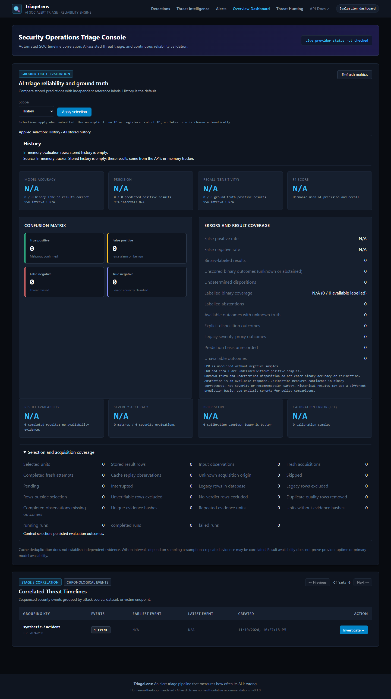
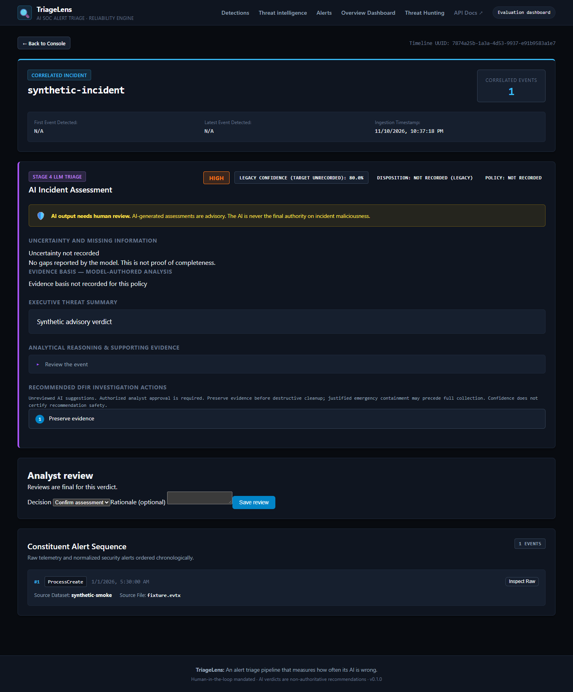
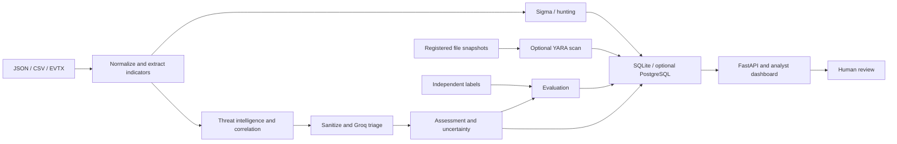

# TriageLens

> An alert triage pipeline that measures how often its AI is wrong.

[](https://github.com/KrishnenduOfficial/triagelens/actions/workflows/ci.yml)
[](https://gitdiagram.com/krishnenduofficial/triagelens?utm_source=readme&utm_medium=badge)
[](https://www.python.org/)
[](https://fastapi.tiangolo.com/)
[](https://react.dev/)
[](https://www.typescriptlang.org/)
[](https://www.sqlite.org/)
[](https://www.postgresql.org/)
[](rules/sigma/)
[](requirements-yara.txt)
[](TASKS.md#roadmap-progress)
[](TASKS.md#roadmap-progress)
[](LICENSE)

Test-count badges show previously recorded offline runs, not a live count or a
claim about the current checkout. The CI badge reports GitHub's workflow status.

TriageLens assists security analysts with alert intake, threat intelligence,
event correlation, cloud-based AI triage, detection and evaluation. It compares
AI assessments with independent labels when available and records uncertainty;
the analyst retains authority over investigation and response.

**Contents:** [Architecture](#1-system-architecture) · [Principles](#2-core-engineering-principles) ·
[AI and evidence](#3-groq-capabilities-and-verification) · [Stack](#4-technology-stack) ·
[Metrics](#evaluation-mathematics) · [Setup and operations](#5-quickstart-guide) ·
[API](#6-api-reference) · [Limitations](#7-known-limitations--operational-boundaries) ·
[Repository](#8-repository-structure) · [License](#9-license)

**Current status:** Groq is the active inference provider; SQLite is the default
database. Real EVTX intake and detection features are implemented, but reviewed
real-data evaluation and live quality acceptance of the current `triage-v2`
policy remain pending. See [evaluation evidence](#3-groq-capabilities-and-verification)
and [project progress](TASKS.md).

| Capability | Support and boundaries |
| --- | --- |
| Alert intake | JSON, CSV and EVTX normalization, with source provenance |
| Intelligence | VirusTotal, AbuseIPDB and URLhaus; credentials and availability vary |
| Correlation | Deterministic grouping and time-windowed timelines |
| AI triage | Groq structured assessments, evidence references and explicit uncertainty |
| Detection | Curated Sigma subset, KQL-style hunting, optional YARA-X and ATT&CK annotations |
| Evaluation | Independent labels, confusion metrics, calibration, coverage and metric scopes |
| Analyst workspace | FastAPI and React dashboard, including separate analyst review |
| Storage and deployment | SQLite by default; optional PostgreSQL, Compose and saved-hunt worker |

### Dashboard preview


*Dashboard overview using synthetic data.*


*Timeline and analyst review using synthetic data.*

[Set up the project](#5-quickstart-guide) · [Run the end-to-end example](#54-end-to-end-execution-sequence) · [Explore the repository](#8-repository-structure)

---

## 1. System Architecture



Labels, model assessments, rule detections and analyst dispositions remain
distinct. Stored evidence references are structural links, not proof that a
model claim is factually supported. See [architecture decisions](docs/ADR_INDEX.md).

For example, a synthetic process event is normalized into an alert, its extracted
indicators can be enriched, and related alerts become a timeline. A sanitized
timeline can produce a Groq assessment; if independent labels are available, the
evaluator scores it. The dashboard presents the evidence, model output and any
separate analyst review. Provider failures are recorded as unavailable outcomes.
The correlation engine defaults to a 30-minute gap and a 100-event cap; shared
identifiers support grouping but do not prove that events belong to one incident.

Six functional stages turn alert telemetry into analyst-reviewed results:

```text
JSON / CSV / EVTX alerts
    -> Intake: normalize records and preserve source evidence/labels
    -> Enrichment: VirusTotal, AbuseIPDB and URLhaus lookups
    -> Timeline builder: correlate identities and split event sessions
    -> Groq triage: sanitize evidence, request strict JSON, validate verdict
    -> Evaluation: compare predictions with independent ground truth
    -> Dashboard: inspect timelines, verdicts and scoped reliability metrics

SQLite stores alerts, intelligence, verdicts, outcomes and run provenance.
FastAPI serves stored results and parameterized hunting queries to React.
The human analyst retains final investigation and response authority.
```

`src/engine/llm.py` owns shared privacy, prompt and cache processing;
`src/engine/groq.py` owns the active provider's request/response contract.
The pipeline's implementation is verified offline. An operator-checked three-case
CLI/database/API/dashboard run matched stored counts (three unavailable outcomes,
zero scored; 2026-11-09). Successful-verdict display and broader interactive UI
verification were not established by that run; it does not establish AI quality.
Later synthetic browser checks are recorded in [TASKS.md](TASKS.md).

---

## 2. Core Engineering Principles

1. **Human Analyst Authority:** AI output provides structured evidence and suggested response actions, never autonomous remediation.
2. **Independent Ground Truth (ADR-008):** AI predictions and reference labels are stored and evaluated separately. The prompt serializer recursively filters structured evaluation/provenance metadata beneath allow-listed telemetry fields, including nested lists and key variants (ADR-040). Original evidence and independent provider detection counts are preserved. Dataset adapters must keep labels and provenance out of free-form observable text; see the [prompt-isolation verification](docs/results/prompt_isolation_20261108.md).
3. **Prompt Injection Boundaries (ADR-023):** Evidence is delimited as untrusted input and the model is instructed not to follow instructions in it. This does not guarantee resistance to prompt injection.
4. **PII and Secret Scrubbing (ADR-018, ADR-019):** Masking targets credentials, private keys, emails and other supported patterns before external transmission; it cannot guarantee removal of every sensitive value.
5. **Measurable Confidence Calibration (ADR-025):** Model confidence scores are evaluated using Brier scores and Expected Calibration Error (ECE) across 5 probability bins.
6. **SQL Injection Defense (ADR-015, ADR-019):** KQL-style hunting filter expressions are compiled to parameterized queries for the supported SQLite and PostgreSQL dialects.

---

## 3. Groq Capabilities and Verification

### 3.1 What the model does in TriageLens

Groq receives sanitized chronological security evidence and returns a structured
assessment: independent disposition, severity, confidence, summary, supporting reasoning, recommended
investigation actions, uncertainty and missing information. It assists analysts;
it does not execute containment, run tools or independently verify its own claims.

The application enforces evidence/label separation, secret masking, strict JSON
schema, local type/range checks, answering-model attribution and cache provenance.
Refused, truncated, mismatched or invalid responses become unavailable outcomes.
These are tested software boundaries, not a guarantee against every model error
or adversarial prompt. `GROQ_FALLBACK_MODELS` is empty by default.

### 3.2 Operator-observed live result — 2026-11-08

| Check | Observed result |
|---|---|
| Provider / model | Groq / `openai/gpt-oss-120b` |
| HTTP / verdict validation | 200 / valid |
| Elapsed time | 1248.8ms (one observation) |
| Requests / fallback / cache | 1 / 0 / disabled |
| Transport | Connection, TLS, upload and response phases completed |

Evidence: [Groq migration and live verification](docs/results/groq_migration_20261108.md).
That initial result was operator-supplied. A later agent-run sample is described below.
A successful schema check does not establish correct severity or safe recommendations.

### 3.3 Six-case evaluation and remaining quality work

Six preselected synthetic cases (three malicious, three benign) produced six
HTTP 200/schema-valid verdicts with no retries, fallback, cache or enrichment.
Binary counts were TP=3, TN=3, FP=0, FN=0. Exact severity agreement was 1/6 (16.7%).
Mean request time was 1.24 seconds. Saved results matched the API's History, Run
and Fresh attempts metrics and rendered through the dashboard's real component.

The review found unsupported assertions and a recommendation to delete a dump
without specifying evidence preservation first. The subsequent
[offline audit](docs/results/severity_safety_audit_20261108.md) confirmed missing
policy criteria and a malicious/LOW reference conflicting with severity-derived
binary scoring. The approved `triage-v1` contract and recommendation policy are
now implemented and verified offline (ADR-056). These six measured results predate
that policy and are unchanged. The subsequent selected `triage-v1` live check made
six successful requests: TP=3/TN=1/FN=1 across five labelled cases, one unlabelled
UNDETERMINED response, and exact severity agreement 3/5. Saved metrics matched all
four API scopes and static dashboard rendering. Review still found unsupported
TLS/success/legitimacy assertions and incomplete containment qualification. This
does not establish safe recommendations or an improvement over a different sample.
See [new-policy results and remaining gaps](docs/results/triage_v1_live_check_20261108.md).
Injection resistance, real-world generalization and sustained availability remain
unmeasured. The
repository's 70-case dataset is synthetic, not a real-world SOC benchmark.
See the [six-case evidence and limitations](docs/results/groq_evaluation_report.md).

New assessments separate `disposition` (MALICIOUS, BENIGN or UNDETERMINED) from
severity (response priority/impact). A malicious event can have LOW priority.
The active policy is now **`triage-v2` / `evidence-basis-v1`** (ADR-057), implemented
and verified offline after the v1 review. It adds a ninth response field with
declared support, observations, hypotheses, gaps and references to captured
sanitized evidence. Binary answers require observed references and no declared
blocking gap. UNDETERMINED requires HIGH uncertainty and a blocking gap;
it counts as available but contributes to neither binary accuracy nor calibration.
Severity agreement remains independently scored when a reference severity exists.
Confidence concerns disposition correctness, not severity or action safety.

The [versioned policy](src/engine/triage_policy.py) requires evidence-qualified
claims, authorized analyst review, and preservation before destructive cleanup.
Emergency containment may precede full collection when observed ongoing harm
justifies it; the analyst must assess scope, urgency and evidence-loss tradeoffs.
Nonblank summary, reasoning and recommendations are validated locally. Free-text
correctness and safety still require human review; structural validation cannot
certify them. The exact system prompt and policy identity enter cache fingerprints.
New references and basis relationships are checked on fresh output and cache
return; the UI resolves citations against the saved sanitized snapshot. It shows
uncertainty and gaps before actions, distinguishing assessed empty lists from
unrecorded legacy values. References prove traceability, not entailment. Labelled
binary coverage and abstentions are shown alongside accuracy. Live v2 schema
acceptance and semantic quality remain unmeasured; earlier results are not v2 scores.
Old records retain their original scores and null/unrecorded new metadata;
History may mix scoring generations, so use explicit cohorts for comparisons.

### 3.4 Historical benchmark evidence

The [2026-11-06 evaluation](docs/results/evaluation_report_20261106.md) and
[earlier model comparison](docs/results/model_comparison_report.md) used Gemini.
They are archived evidence, not Groq performance claims. Stored history can contain
old models; use explicit run/cohort selections for a current-provider comparison.

## 4. Technology Stack

SQLite is the default; PostgreSQL, Compose, the saved-hunt worker and YARA-X
are optional. Sigma evaluates a documented local subset, and hunting implements
a [KQL-style filter](docs/HUNTING_DSL.md), not the full KQL language. ATT&CK
coverage describes annotations on recorded hits, not detection effectiveness.
EVTX intake is available, while independently reviewed real-data evaluation
remains pending. The current `triage-v2` policy has not had live quality acceptance.
The repository contains a CI workflow; its hosted execution is not established by
the local verification recorded in [TASKS.md](TASKS.md).

| Layer | Technologies | Purpose |
| :--- | :--- | :--- |
| **Core Processing** | Python 3.14, Pydantic 2.x | Normalization, pipeline orchestration, data validation |
| **Backend API** | FastAPI 0.162, Uvicorn, Starlette | High-performance async REST API and OpenAPI schema |
| **Database** | SQLite 3 by default, optional PostgreSQL 17 | Relational persistence with backend-specific migrations |
| **AI Inference** | Groq chat-completions API | Cloud DFIR triage (`openai/gpt-oss-120b`, strict JSON schema) |
| **Protocol Abstraction**| `TriageProvider` Protocol | Provider-independent interface for interchangeable LLM backends |
| **Response Caching** | `LLMResponseCache` | In-memory thread-safe LRU/TTL cache with SHA-256 keys |
| **HTTP Client** | HTTPX | Sync and async external intelligence and Groq communication |
| **Threat Intelligence**| VirusTotal, AbuseIPDB, URLhaus | Indicator enrichment for IP addresses, domains, and file hashes |
| **Query Engine** | KQL-style hunting filter with SQLite and PostgreSQL dialects | Parameterized security hunting queries with JSON path extraction |
| **Testing** | Pytest, Node test runner, Playwright | Unit, integration, security and browser checks |
| **Frontend** | React 19, TypeScript 7, Vite 8, custom CSS | Dark-mode SOC analyst investigation console |
| **Detection and intake** | `evtx`, pySigma, optional YARA-X, ATT&CK data | Event intake, bounded rule evaluation and technique annotation |
| **Deployment** | Optional PostgreSQL, Alembic, Docker Compose | Role-separated storage, migrations and local service stack |

---

## Evaluation mathematics

An independent label is the reference for scoring; an analyst review is recorded
separately and is not automatically ground truth. Evaluation manifests fix cohort
membership and development/test splits. Record the policy, provider, model and
scope with any result: History counts stored evaluation rows, Run counts run
occurrences, Quality selects declared case/evidence/context/policy combinations,
and Fresh attempts concerns completed fresh acquisitions. Replay and missing
outcomes affect interpretation. Small synthetic cohorts cannot establish field
performance; see the [real-data evaluation status](docs/results/real_data_evaluation_20261109.md).

For independently labelled binary assessments, let TP, TN, FP and FN denote
true positives, true negatives, false positives and false negatives, and let
`N = TP + TN + FP + FN`. These counts exclude unavailable outcomes, unknown
truth and abstentions. The selected metric scope determines the counting unit.

$$
\begin{aligned}
\mathrm{Accuracy} &= \frac{TP+TN}{TP+TN+FP+FN}, &
\mathrm{Precision} &= \frac{TP}{TP+FP}, \\
\mathrm{Recall} &= \frac{TP}{TP+FN}, &
\mathrm{Specificity} &= \frac{TN}{TN+FP}, \\
\mathrm{F1} &= \frac{2TP}{2TP+FP+FN}, &
\mathrm{FPR} &= \frac{FP}{FP+TN}, \quad
\mathrm{FNR} = \frac{FN}{FN+TP}.
\end{aligned}
$$

| Metric | Formula | Interpretation |
| --- | --- | --- |
| Accuracy | `(TP + TN) / N` | Correct binary predictions among scored predictions |
| Precision | `TP / (TP + FP)` | Fraction of positive predictions that are correct |
| Recall | `TP / (TP + FN)` | Fraction of labelled positives found |
| Specificity | `TN / (TN + FP)` | Fraction of labelled negatives correctly classified |
| F1 | `2 × precision × recall / (precision + recall)` | Harmonic mean of precision and recall |
| False-positive rate | `FP / (FP + TN)` | Fraction of labelled negatives predicted positive |
| False-negative rate | `FN / (FN + TP)` | Fraction of labelled positives predicted negative |
| Severity agreement | exact matches / evaluated severities | Separate from binary disposition |
| Labelled binary coverage | labelled binary predictions / available labelled outcomes | Discloses abstentions among labelled available outcomes |
| Availability | available outcomes / (available + unavailable outcomes) | Availability of the selected stored evaluation stream, not live uptime |

Zero denominators require care: the base tracker returns zero for some metrics
and a validity flag or null for others; protocol and scope presentations can
report undefined values. Consult the selected response and its denominators.

For calibration, let $c_i$ be confidence in the **selected disposition** and
$y_i=1$ when that disposition is correct, otherwise $y_i=0$. For $n$ scored
confidence pairs, the Brier score is:

$$
\mathrm{Brier}=\frac{1}{n}\sum_{i=1}^{n}(c_i-y_i)^2
$$

For five equal-width confidence bins $B_k$, expected calibration error (ECE) is:

$$
\mathrm{ECE}=\sum_{k=1}^{5}\frac{|B_k|}{n}\left|\mathrm{confidence}(B_k)-\mathrm{accuracy}(B_k)\right|
$$

Here, $\mathrm{confidence}(B_k)$ is the bin's mean confidence and
$\mathrm{accuracy}(B_k)$ is its observed accuracy. The implementation rounds
both values before aggregation.
Abstentions are excluded from calibration.

For a rate $\hat p=s/n$, where $s$ is the number of successes, the Wilson
interval is given by:

$$
\frac{\hat p+\frac{z^2}{2n}\ \pm\ z\sqrt{\frac{\hat p(1-\hat p)}{n}+\frac{z^2}{4n^2}}}{1+\frac{z^2}{n}},\qquad z\approx1.96.
$$

The stated $z$ value gives a 95% confidence interval. Intervals describe sampling
uncertainty under their assumptions, not label quality.

The synthetic Sigma fragility demo divides lost matches by successfully evaluated,
changed mutations of matching baselines. It excludes no-ops and reports errors and
unsupported cases. Run `python scripts/run_rule_fragility.py` offline; this is not
a measurement of real-world adversary behavior. For definitions, scope and frozen
cohorts see [architecture](ARCHITECTURE.md) and [evaluation implementation](src/engine/evaluation.py).

## 5. Quickstart Guide

### 5.1 Prerequisites

- Python 3.14, the version used for the verified pinned environment.
- Node.js satisfying the installed Vite requirement: `^20.19.0 || >=22.12.0`, plus npm.
- The commands below target Windows/PowerShell. Linux CI checks have also been
  exercised locally; see [TASKS.md](TASKS.md) for their scope.
- Cloud inference avoids running a local model. Hardware performance has not been
  benchmarked; the project targets a modest workstation.

---

### 5.2 Backend Setup

1. **Clone the repository:**
   ```powershell
   git clone https://github.com/KrishnenduOfficial/triagelens.git
   cd triagelens
   ```

2. **Create and activate a virtual environment (PowerShell):**
   ```powershell
   python -m venv .venv
   .\.venv\Scripts\Activate.ps1
   ```
   On a POSIX shell, activation is `source .venv/bin/activate`.

3. **Install dependencies:**
   ```powershell
   python -m pip install -r requirements.txt
   ```

4. **Configure environment variables:**
   ```powershell
   if (-not (Test-Path -LiteralPath .env)) {
       Copy-Item .env.example .env
   }
   ```
   Edit `.env` to configure your API keys and model parameters:
   ```env
   GROQ_API_KEY=your_groq_api_key_here
   GROQ_MODEL=openai/gpt-oss-120b
   GROQ_FALLBACK_MODELS=
   DATABASE_PATH=data/triagelens.db
   VIRUSTOTAL_API_KEY=
   ABUSEIPDB_API_KEY=
   URLHAUS_API_KEY=
   ```
   Groq needs a real key for live triage. Intelligence credentials are optional:
   enter real values for services you use and leave unused credentials blank,
   including `URLHAUS_API_KEY` in the template. Example placeholder strings are
   treated as configured credentials; they are not working API keys.
   *(Note: `TRIAGELENS_DB_PATH` is also recognized as an alias for `DATABASE_PATH`, and `VT_API_KEY` as an alias for `VIRUSTOTAL_API_KEY`).*

   `VIRUSTOTAL_MIN_DETECTIONS` defaults to 3 malicious engine detections;
   set it to a positive integer to adjust the enrichment flag. A result below
   the threshold, including one or two detections, does not prove an indicator
   is safe. `ENRICHMENT_WAIT_MODE` defaults to `false`; set it to `true` to
   allow rate-limit waits bounded by `ENRICHMENT_MAX_WAIT_SECONDS`.
   `ENRICHMENT_MAX_LOOKUPS_PER_RUN=0` is parsed as no cap, but the environment
   variable is currently unused by the runtime, even when set to a positive
   value. Use the CLI `--max-lookups` option to enforce a per-run lookup cap.

   CLI, API, and the evaluation runner share database resolution: explicit CLI
   override, nonblank `DATABASE_PATH`, nonblank `TRIAGELENS_DB_PATH`, then
   `data/triagelens.db`. Relative paths use the project root containing `src/`,
   regardless of the process working directory; absolute paths retain their target.
   Parent directories are created consistently. Blank explicit overrides and
   filesystem errors fail before SQLite opens. Windows drive-only/root-only paths
   must be replaced with fully qualified or ordinary project-relative paths.
   `:memory:` explicitly selects an ephemeral database local to each connection.

   `--db-path` affects only that CLI/evaluation invocation. Configure the API with
   the same target and restart it after changing configuration. Existing databases
   are not moved or merged. The historical root `triagelens.db` is separate from
   the default `data/triagelens.db`; to select it, use `DATABASE_PATH=triagelens.db`
   consistently for both processes. A genuinely empty selected database still
   produces zero metrics. See the [path verification](docs/results/database_paths_20261108.md).

   The template also documents `GROQ_REQUESTS_PER_MINUTE`,
   `GROQ_TOKENS_PER_MINUTE`, `GROQ_ESTIMATED_TOKENS_PER_REQUEST`,
   `GROQ_MAX_WAIT_SECONDS`, `DATABASE_BACKEND`, `YARA_SCAN_ROOTS`,
   `ALLOWED_ORIGINS` and `VITE_API_BASE_URL`. See [.env.example](.env.example)
   for defaults and optional PostgreSQL settings. Never commit real credentials.

   **Troubleshooting:** Missing Groq credentials prevent live triage; provider
   quotas and timeouts can yield unavailable results. An empty dashboard can
   indicate an empty database or a different API database path. Check the API
   health endpoint, the configured path and browser origin, then restart the API
   after configuration changes. A missing enrichment response is not a clean finding.

---

### Optional PostgreSQL storage

#### Local Compose stack

Docker Desktop with the Linux engine and Compose is required. The stack exposes
only `http://127.0.0.1:8080`, has no authentication, and is intended for local
use. It starts an empty PostgreSQL database; it does not import SQLite history.
From the project root in PowerShell, create five distinct random passwords in an
ignored runtime file, then start the services:

```powershell
if (Test-Path .env.compose) { throw 'Keep the existing .env.compose; do not overwrite its passwords.' }
$names = 'TL_ADMIN_PASSWORD','TL_ANALYST_PASSWORD','TL_HUNT_PASSWORD','TL_EVALUATOR_PASSWORD','TL_TRIAGE_PASSWORD'
$bytes = [byte[]]::new(32)
$lines = foreach ($name in $names) { [System.Security.Cryptography.RandomNumberGenerator]::Fill($bytes); "$name=$([Convert]::ToHexString($bytes))" }
[System.IO.File]::WriteAllLines((Join-Path (Get-Location) '.env.compose'), $lines)
docker compose --env-file .env.compose up --build -d
docker compose --env-file .env.compose ps
```

Open the dashboard at `http://127.0.0.1:8080`; `/health` checks API database
connectivity. PostgreSQL is not exposed on the host. The migration service creates
separate logins; the API receives only analyst and read-only hunting credentials.
Provider credentials can be supplied in `.env.compose` for explicitly initiated
enrichment; do not put secrets in `VITE_*` variables or images. Compose environment
variables are visible to users with Docker access. The memory limits total 2.625 GiB,
excluding Docker's own overhead. `docker compose --env-file .env.compose down`
stops the stack while retaining the database volume. Keep `.env.compose`: generating
new passwords does not change the PostgreSQL administrator password in an existing
volume.

#### PostgreSQL backup and restore

This procedure covers the local Compose PostgreSQL database, not SQLite files. It
uses a data-only archive and the existing migrations to recreate the schema and
grants. Store the archive and revision file together in an access-restricted,
encrypted location outside the repository: they contain sensitive alerts, labels,
reviews and other investigation data. Keep `.env.compose` securely and separately;
the archive does not contain cluster roles, passwords or external provider keys.
Choose a new backup directory that does not already contain these filenames.

Stop all writers, including the optional worker and any external CLI or evaluation
processes, and do not run migrations during the backup. From the project root in
PowerShell, with the database running, set `$backupDir` to that directory:

```powershell
docker compose --env-file .env.compose --profile jobs stop api worker
$db = docker compose --env-file .env.compose ps -q db
if (-not $db) { throw 'Start the database first.' }
docker exec $db psql -X -U triagelens_admin -d triagelens -At -v ON_ERROR_STOP=1 -c 'SELECT version_num FROM triagelens.alembic_version' | Set-Content -Encoding utf8 (Join-Path $backupDir 'revision.txt')
if ($LASTEXITCODE -ne 0) { throw 'Could not read migration revision.' }
docker exec $db pg_dump -U triagelens_admin -d triagelens -Fc --data-only --exclude-table-data=triagelens.alembic_version -f /tmp/triagelens-backup.dump
if ($LASTEXITCODE -ne 0) { throw 'Backup failed.' }
docker cp "${db}:/tmp/triagelens-backup.dump" (Join-Path $backupDir 'triagelens.dump')
if ($LASTEXITCODE -ne 0) { throw 'Copy failed.' }
docker exec $db rm /tmp/triagelens-backup.dump
```

Resume the stack with `docker compose --env-file .env.compose --profile jobs up -d`
if the worker is used; omit `--profile jobs` otherwise. Check the archive and
revision file exist and regularly test recovery. A dump is a point-in-time snapshot,
not continuous recovery; changes after it are not included.

Restore first into a **new, isolated Compose project and empty volume**, never over
an existing database. Use the same trusted code and migrations as the backup;
build the application image from that checkout before starting the target. The
commands below use project name `triagelens-recovery`, which must not already
exist. Use the protected credentials file intended for the target and ensure its
optional queue password is set if the worker is needed. Stop and investigate any
failed command. Do not restore an archive from an untrusted source.

```powershell
docker compose --env-file .env.compose -p triagelens-recovery up -d --build db migrate
if ($LASTEXITCODE -ne 0) { throw 'Target startup failed.' }
$migration = docker compose --env-file .env.compose -p triagelens-recovery ps -aq migrate
if ((docker wait $migration) -ne '0') { throw 'Target migration failed.' }
$target = docker compose --env-file .env.compose -p triagelens-recovery ps -q db
$revision = docker exec $target psql -X -U triagelens_admin -d triagelens -At -v ON_ERROR_STOP=1 -c 'SELECT version_num FROM triagelens.alembic_version'
if ($LASTEXITCODE -ne 0 -or $revision.Trim() -ne (Get-Content (Join-Path $backupDir 'revision.txt') -Raw).Trim()) { throw 'Revision mismatch; do not restore.' }
docker cp (Join-Path $backupDir 'triagelens.dump') "${target}:/tmp/triagelens-restore.dump"
if ($LASTEXITCODE -ne 0) { throw 'Copy failed.' }
docker exec $target pg_restore -U triagelens_admin -d triagelens --exit-on-error --single-transaction /tmp/triagelens-restore.dump
if ($LASTEXITCODE -ne 0) { throw 'Restore failed; investigate before using target.' }
docker exec $target rm /tmp/triagelens-restore.dump
```

If restore fails, discard the isolated target and start again with an empty volume;
sequence changes are not necessarily rolled back with the transaction. Before
directing users or jobs to the recovered instance, verify representative
records, independent labels, saved hunts, role permissions and application behavior.
The migration recreates the version row and permissions; the archive deliberately
excludes that row. The archive does not restore custom database settings, custom
roles or changes outside the tracked migrations. In-flight jobs may be retried
after recovery; check their state before enabling the worker. This procedure was
tested with synthetic data on PostgreSQL 17, not as a production disaster drill.

SQLite remains the default. For a fresh UTF-8 PostgreSQL 17 database, install the
optional dependencies and run the baseline as a migration owner with permission
to create schemas and roles. Set `TRIAGELENS_POSTGRES_MIGRATION_DSN` in that
process before running Alembic.

```powershell
python -m pip install --only-binary=:all: -r requirements-postgres.txt
python -m alembic upgrade head
```

Provision separate non-owner logins for the four baseline roles and the optional
worker role. Grant each login membership in just its corresponding group role.
Supply distinct credentials through process-scoped environment variables.

| Group role | Connection variable | Caller |
| --- | --- | --- |
| `triagelens_evaluator` | `TRIAGELENS_POSTGRES_EVALUATOR_DSN` | CLI and evaluation coordinator |
| `triagelens_triage` | `TRIAGELENS_POSTGRES_TRIAGE_DSN` | Restricted inference cache |
| `triagelens_analyst` | `TRIAGELENS_POSTGRES_ANALYST_DSN` | API and job submission/status |
| `triagelens_hunt` | `TRIAGELENS_POSTGRES_HUNT_DSN` | Read-only hunting queries |
| `triagelens_queue` (optional) | `TRIAGELENS_POSTGRES_QUEUE_DSN` | Worker claims and job results |

Set `DATABASE_BACKEND=postgresql` for the API, CLI, and standard evaluation runner.
An explicit `--db-path` selects SQLite for that invocation. The dedicated live
protocol requires this explicit SQLite path. The PostgreSQL baseline starts empty
and leaves SQLite history in its original file.

#### Saved-hunt worker

The optional PostgreSQL worker runs an existing saved hunting filter and stores
its returned row count, capped at the requested limit (1–1,000, default 500).
Save the hunt in the dashboard first. Submission snapshots the filter. Use the
same job ID, hunt name, and limit to retry a submission, including after the
saved hunt is edited or removed. Use a fresh ID to run it again.

To enable the Compose worker, add a distinct `TL_QUEUE_PASSWORD` to the ignored
`.env.compose` file. Generate it once, then keep it with the other credentials.

```powershell
if (-not (Select-String -LiteralPath .env.compose -Pattern '^TL_QUEUE_PASSWORD=' -Quiet)) {
    $queueBytes = [byte[]]::new(32)
    [System.Security.Cryptography.RandomNumberGenerator]::Fill($queueBytes)
    Add-Content -LiteralPath .env.compose -Value "TL_QUEUE_PASSWORD=$([Convert]::ToHexString($queueBytes))"
}
docker compose --env-file .env.compose --profile jobs up --build -d
$jobId = [guid]::NewGuid().ToString()
docker compose --env-file .env.compose exec api python deploy/start.py queue enqueue 'My saved hunt' $jobId --limit 500
docker compose --env-file .env.compose exec api python deploy/start.py queue status $jobId
```

The worker adds a 256 MiB limit to the Compose stack. To stop the stack with
the worker enabled, use `docker compose --env-file .env.compose --profile jobs down`.

For standalone PostgreSQL, apply `python -m alembic upgrade head` and grant
`triagelens_queue` to a dedicated login. Set the queue and hunt DSNs in the
worker process and run `python -m src.worker run`. In a separate process with
the analyst DSN, use `python -m src.worker enqueue 'My saved hunt' <job-id>`
and `python -m src.worker status <job-id>`. Use `run --once` for a single poll.

Claims use 30-second leases. Transient failures and expired leases can retry
after 5 and 10 seconds, with at most three attempts. An expired attempt may
repeat the read-only query against current data. The lease token prevents a
stale attempt from publishing a result. Job rows and filter snapshots remain
in PostgreSQL. Status shows a bounded count or a short failure code.

To run the offline regression checks, set `TRIAGELENS_TEST_POSTGRES_DSN` to a
disposable PostgreSQL instance on `127.0.0.1` using a login that can create
temporary test databases and roles. Then run:

```powershell
python -m pytest -q -x --tb=short tests/test_database_contract.py tests/test_compose_startup.py
```

The trusted evaluator preserves independent labels and raw records. The triage
login reads verdicts only. The hunt login queries a read-only analyst view that
includes alert labels, with a server-side statement timeout. The raw record has a
JSONB GIN index for supported containment queries. Time partitioning is disabled.
Within each CLI or evaluation run, the trusted coordinator passes a label-filtered
timeline and a restricted cache login to the inference stage in the same process.

For verification, point `TRIAGELENS_TEST_POSTGRES_DSN` at an administrative login
on a disposable instance at `127.0.0.1`. The tests create and remove a test
database and test logins. The baseline group roles remain on the test instance.

```powershell
python -m pytest -q -x --tb=short tests/test_database_contract.py
```

---

### Optional YARA snapshot scanner (Windows, offline)

The base install works without YARA. To enable the T3.2 scanner, install the
separate pinned extra (Windows x64 wheel, BSD-3-Clause):

```powershell
python -m pip install --only-binary=:all: -r requirements-yara.txt
```

Scan immutable bytes acquired by a trusted caller; the worker receives no sample
path. This harmless example compiles one original demonstration rule:

```python
from src.engine.yara import RuleSource, scan_snapshot

source = '''rule demo_marker {
    meta:
        id = "demo.marker"
        author = "TriageLens example"
        source = "https://example.invalid/triagelens-demo"
        revision = "v1"
        license = "MIT"
    strings:
        $marker = "TriageLens harmless marker"
    condition:
        $marker
}'''
result = scan_snapshot(b"TriageLens harmless marker", (RuleSource("demo", source),))
print(result.status, result.size, result.engine, result.version)
```

`match` and `no_match` describe this exact SHA-256 snapshot and rule-pack digest,
never a malicious/benign disposition. Missing optional package returns
`missing_engine`; unsupported versions/platforms or failed isolation return
`unavailable`. Compile errors identify the zero-based source index, category/code
and line when available, without snippets or exception text. Timeout, resource
exhaustion, worker failure and truncation remain separate incomplete outcomes.
Matches contain attributed rule metadata and bounded offsets/lengths, never bytes.
Missing or invalid ATT&CK annotations retain the hit with explicit diagnostics.

The optional pack in `rules/yara` has two original text-pattern rules and two
adapted rules from [Marcin Ulikowski's yara-rulz](https://github.com/elceef/yara-rulz/blob/main/rules/Suspicious_BAT.yara).
The upstream MIT notice is in `rules/yara/LICENSE-elceef.txt`. The adaptations
retain the detection strings and conditions, replace metadata to meet the scanner
contract, and add TriageLens technique mappings. The upstream source URL tracks a
moving branch; the recorded upstream dates are not immutable commit identifiers.
The local files and scanner pack digest identify the actual scanned rules.
To scan a harmless snapshot with all four reviewed sources:

```python
from pathlib import Path
from src.engine.yara import RuleSource, scan_snapshot

paths = sorted(Path('rules/yara').glob('*.yar'))
pack = tuple(RuleSource(p.stem, p.read_text(encoding='utf-8')) for p in paths)
result = scan_snapshot(b'powershell -encodedcommand example', pack)
print(result.status, [match.rule for match in result.matches])
```

These patterns can match benign text, need not indicate execution, and have no
measured real-world detection quality. ATT&CK IDs describe rule mappings, not
verified observations; a human must investigate matches.

Limits: 16 MiB/snapshot, 30 sources (one rule per unique namespace), 1 MiB total
source and 10,000 patterns. Includes and imports are rejected conservatively even
inside comments/strings; native includes are also disabled. Every rule requires
string metadata `id`, `author`, `source` (HTTPS reference), `revision` and `license`;
optional `mitre_attack` contains comma-separated technique IDs. Other metadata is
rejected. Only reviewed text sources are accepted, never serialized native rules.
Archive signatures are rejected; bytes are never executed or unpacked.

A fresh [Windows AppContainer](https://learn.microsoft.com/en-us/windows/win32/secauthz/implementing-an-appcontainer)
with no network capabilities runs each scan in a Job Object: 512 MiB committed
memory, 10 seconds user CPU, one process, kill on parent exit. Parent monitoring
enforces a 10-second compile/startup deadline and 20-second worker wall deadline;
the [YARA-X scanner](https://virustotal.github.io/yara-x/docs/api/python/) also has
a 5-second scan timeout. Windows checks CPU limits periodically; these are not
hard real-time guarantees. Results cap occurrences at 100/pattern, 1,000/file and
256 KiB JSON; reaching a cap is reported as `truncated`. `Limits` can tighten bounds.
One scan is admitted per Python process; concurrent calls return `busy`.

The launcher stages trusted interpreter/stdlib/extension files in a disposable
temporary directory, grants its fresh identity read/execute access only there,
and supplies a minimal environment. It never changes installed-runtime ACLs or
grants sample-directory/database access. Normal exit removes the profile/runtime;
an abrupt parent exit kills the worker but may leave the empty profile and copied
runtime for later operator cleanup. Runtime staging has a 60-second overall budget
checked before IPC; blocking filesystem/OS setup calls are not preemptible.
The API can scan an explicitly registered local Windows directory. Set the roots
before starting the API; an empty setting disables directory scanning. Roots must
be fixed local directories outside the project, system, program and known credential
directories. For example, replace the path below with an existing local directory:

```powershell
$env:YARA_SCAN_ROOTS = '{"samples":"C:\\triagelens-samples"}'
uvicorn src.api.main:app --host 127.0.0.1 --port 8000
```

In another PowerShell window, submit a registered root ID, optional relative
directory, and caller-generated job ID. Use harmless files for local testing:

```powershell
$job = [guid]::NewGuid().ToString()
$body = @{ job_id = $job; root_id = 'samples'; relative_path = '' } | ConvertTo-Json
$run = Invoke-RestMethod -Method Post -Uri 'http://127.0.0.1:8000/api/yara/scans' -ContentType 'application/json' -Body $body
$run
Invoke-RestMethod "http://127.0.0.1:8000/api/yara/jobs/$job"
Invoke-RestMethod "http://127.0.0.1:8000/api/yara/scans/$($run.scan_ids[0])"
```

The job reports rejected files and incomplete scope. A retry with the same job ID
and request returns its recorded state; reuse with different inputs is rejected.
If the process stops during a job, its recorded `running` state requires a new job
ID for another attempt. File reads use pinned Windows handles and reject reparse
points, hard links, alternate streams and recognized archives. Limits are 1,000
entries, four directory levels, 100 files, 16 MiB/file, 128 MiB/job, and a 60-second
job deadline. Blocking filesystem calls and database operations are not preemptible.
API scan admission is serialized within the Windows logon session; direct calls to
`scan_snapshot` retain their separate per-process admission. No file or path is sent
to a provider. Scan results and qualified YARA hits are stored separately from AI
output and labels; a hit links to existing alerts only on an exact lowercase SHA-256
indicator. An unmatched hit remains in the scan record. Linking does not imply execution.

To explicitly look up a stored snapshot hash with the configured VirusTotal
provider, use `POST /api/yara/scans/{scan_id}/enrichment`. This sends only the hash
to the provider under the existing quota and cache rules; it is never automatic.
`unavailable`, an incomplete job, and `no_match` do not establish that a file is safe.
Offline adversarial file tests are recorded under T3.5 in [TASKS.md](TASKS.md).
No detection-quality claim is made.

### 5.3 Run Automated Test Suite

```powershell
python -m pytest -q
cd dashboard
npm ci
npm test
npm run build
cd ..
```

Ordinary pytest blocks real network calls, including when credentials are present.
YARA containment tests use harmless bytes and local TCP/UDP receivers only; they
verify denial against a working local positive control without external hosts.
Run focused checks with `python -m pytest -q -x --tb=short tests/test_yara.py tests/test_yara_windows.py`.
With the optional wheel installed on Windows these include actual isolated scans
and OS probes; without it they check graceful absence rather than native behavior.
Groq wire/schema tests use injected senders or MockTransport. Shared privacy/cache/
provenance tests use a neutral test-only transport; it is not a production provider.
Live provider commands are manual and separate from tests. The latest verified
suite and counts are recorded in the migration report and TASKS.md.

The [CI workflow](.github/workflows/ci.yml) runs backend and dashboard checks,
PostgreSQL-backed tests, dependency and secret scans, and generates SBOMs. Ruff
and mypy gates currently cover limited scopes; Bandit reports findings and gates
high-severity results. The badge at the top links to the hosted workflow; its
displayed status is provided by GitHub and has not been checked in this review.

### EVTX intake (offline)

The EVTX adapter uses [`evtx==0.15.0`](https://pypi.org/project/evtx/0.15.0/)
(MIT, Rust-backed; Windows x64 Python 3.10+ wheels). Keep large inputs outside
the repository. This example parses a local file without enrichment or LLM calls:

```python
from dataclasses import asdict
from src.engine.evtx import EvtxIntakeEngine

intake = EvtxIntakeEngine()
for batch in intake.ingest_evtx(r"C:\soc-data\events.evtx", batch_size=100):
    # Persist/process each batch here; do not collect the entire iterator.
    print("Alerts in batch:", len(batch))
print(asdict(intake.stats))
```

`AlertIntakeEngine.ingest_directory()` also accepts `.evtx` (case insensitive);
its EVTX counters are available as `engine.evtx.stats`. Normalized alerts carry
EventID as `event_type`, UTC `timestamp`, and `original_record` fields `EventID`,
`Channel`, `ComputerName`, `User`, `Details`, and local-only `raw_xml`.
`Details` flattens EventData/UserData with dotted paths, bracket indices for
repeated siblings, and backslash escaping of literal dots/brackets/backslashes.
User selection prefers EventData User, TargetUserName, SubjectUserName, then
the System Security SID. Missing values remain unknown; naive times assume UTC,
invalid/missing times are counted and retained as `None`; precision is microseconds.
Source paths stay in `source_file` provenance, excluded from LLM prompts along
with raw XML. Dataset labels and indicators are not inferred by this adapter.

Limits: unknown channels are retained. Parser errors count failed operations,
which may represent whole chunks; they cannot measure the number of lost records.
Normalization failures count rejected records. File errors and abandonment after
100 consecutive parser errors increment `files_failed`; readable files containing
recoverable errors can have `files_failed=0`. Counters accumulate per adapter.
The adapter uses one native parser thread with checksums enabled and recovery
disabled, buffers one native chunk plus bounded alert batches, and rejects XML
over 1,048,576 characters or event-data nesting over 32 levels. Full CLI correlation
still collects alerts in memory; use the adapter directly for large-file intake.
Offline tests cover synthetic files and parser-output fixtures. A separate
128 MiB synthetic native-parser check emitted 2,048 events with 0.50 MiB observed
working-set growth after warm-up (batch 25, one parser thread). This does not
establish real-data accuracy, throughput, or memory ceilings for unusual templates.

### 5.4 End-to-End Execution Sequence

Run these from the project root with the virtual environment active. Live CLI
runs can contact both Groq and configured intelligence services and consume quota.

1. **Prepare a dedicated synthetic alert input folder:**
   ```powershell
   python scripts/generate_soc_data.py
   New-Item -ItemType Directory -Force data/raw/demo | Out-Null
   Copy-Item data/synthetic_soc_telemetry.json data/raw/demo/telemetry.json
   ```
   `data/raw/` is Git-ignored. Keep alert inputs separate from the benchmark JSON
   and databases; do not feed the entire mixed `data/` directory into alert intake.

2. **Run the pipeline:**
   ```powershell
   python -m src.cli --data-dir data/raw/demo --db-path data/triagelens.db
   ```
   Save the `Evaluation run:` UUID and the final `PIPELINE EXECUTION SUMMARY`
   for the comparison below. A configured Groq key and completed triage outcomes
   are needed for a meaningful AI metric comparison; missing credentials skip
   triage. This command makes live requests and may consume quota; one run of
   this synthetic input produced 50 timelines, potentially requiring 50 triage
   requests before retries. Check your available quota before starting.
   To skip Groq while retaining enrichment:
   ```powershell
   python -m src.cli --data-dir data/raw/demo --db-path data/triagelens.db --skip-llm
   ```
   **`--skip-llm` is not an offline switch:** intelligence lookups can still occur.
   Use the guarded test suite for offline verification.

3. **Check the database populated by that run:**
   ```powershell
   python -c "import sqlite3; c=sqlite3.connect('file:data/triagelens.db?mode=ro', uri=True); print('timelines:', c.execute('SELECT COUNT(*) FROM timelines').fetchone()[0], 'evaluations:', c.execute('SELECT COUNT(*) FROM evaluations').fetchone()[0]); c.close()"
   ```
   The read-only open fails if the file is missing. Existing rows can be from
   earlier runs; the Run selection below isolates this run. A zero evaluation
   count does not demonstrate populated AI metrics.

4. **Start the backend in a separate terminal, from the project root:**
   ```powershell
   .\.venv\Scripts\Activate.ps1
   $env:DATABASE_PATH = 'data/triagelens.db'
   python -m uvicorn src.api.main:app --host 127.0.0.1 --port 8000 --reload
   ```
   Configure the API's `DATABASE_PATH` to the same file as the CLI. Open
   `http://127.0.0.1:8000/docs` for the API or `/api/metrics` for stored metrics.

5. **Start the dashboard in another terminal, initially at the project root:**
   ```powershell
   cd dashboard
   npm ci
   npm run dev
   ```
   Open the local URL printed by Vite (normally `http://localhost:5173`).
   The default backend URL is `http://localhost:8000`. For a different backend,
   put the public URL in `dashboard/.env.local` before starting Vite:
   ```env
   VITE_API_BASE_URL=http://127.0.0.1:8000
   ```
   Vite uses the dashboard directory for its environment files; setting this only
   in the root `.env` does not configure the frontend. Restart Vite after changes.
   Groq and intelligence secrets stay in the root `.env`, never in `VITE_*` values.

---

### 5.5 Manual Click-Through Verification Checklist

- [ ] Open `/health` on the API and verify database connectivity.
- [ ] Open `http://127.0.0.1:8000/api/metrics?scope=run&run_id=<UUID>`,
  replacing `<UUID>` with the CLI's `Evaluation run:` value. Compare `tp`, `tn`,
  `fp`, `fn`, `total`, `unknown`, `abstained` and `unavailable` with the CLI
  summary; compare applicable rates after converting API fractions to percentages.
- [ ] On dashboard `/`, select **Run** under **Scope**, enter the same UUID in
  **Run UUID**, and click **Apply selection**. Verify the displayed Run ID, then
  compare confusion counts, binary-labeled results, unscored outcomes, undetermined
  dispositions, unavailable outcomes and applicable rates with the API and CLI.
  Default History includes earlier evaluations and need not match the latest run.
  N/A can be valid when a rate's denominator is zero; the CLI may print 0% instead.
  Check loading/error states; the UI does not certify live provider availability.
- [ ] Use the timeline list on `/` and follow a row to `/timeline/:id`. Verify its
  alert details, intelligence and stored verdict. There is no `/timelines` page or
  incident-detail drawer in the current router.
- [ ] On `/hunt`, try `event_type == "ProcessCreate"` or
  `CommandLine contains "powershell"`. A valid query may return zero matching rows.
- [ ] Check that failed triage is unavailable rather than a benign prediction and
  that historical model results remain distinguishable from new Groq results.
- [ ] Record whether the same-run numbers match and share screenshots of the CLI
  summary and dashboard selection/results, with sensitive information removed.
  Do not claim this check passed until the operator confirms it on populated data.

---

### Dashboard smoke test and screenshots

The [dashboard previews](#dashboard-preview) use synthetic data and do not
represent measured AI accuracy.

The Playwright smoke test starts a local API with a temporary synthetic SQLite
database and a local dashboard. It does not call threat-intelligence or AI providers.
From PowerShell, after the backend and dashboard dependencies are installed:

```powershell
cd dashboard
npx playwright install chromium
$env:SMOKE_PYTHON = '..\.venv\Scripts\python.exe'
npm run test:e2e
```

Alternatively set `$env:SMOKE_BROWSER = 'msedge'` to use installed Microsoft Edge.
Ports 18741 and 18742 must be free. The test covers one synthetic path, not all
browser combinations, live integrations, or real-data performance.

### 5.6 Groq Verification

From the project root, use these operator commands (each live command is separate):

```powershell
python scripts/diagnose_groq.py --dry-run
# One synthetic full-triage request, no cache/fallback/retry:
python scripts/diagnose_groq.py --timeout 30 --trace
# Optional separate smoke probes; one request per configured provider:
python scripts/check_connections.py --groq-timeout 30
```

Success requires `success: true`, `schema_valid: true`, and the expected answering
model. A dry run checks configuration only. Groq strict JSON schema covers only
model-authored assessment fields; application code supplies identity and provenance.
Truncation, refusal, model mismatch, invalid fields, and HTTP failures remain
unavailable outcomes. TLS remains verified. Trace output contains phase metadata
only. Existing secrets in the parent shell override `.env`; clear stale
`Env:GROQ_API_KEY` if needed and restart running processes after changing settings.

`GROQ_MODEL` defaults to `openai/gpt-oss-120b`; supported strict-schema models also
include `openai/gpt-oss-20b` and `qwen/qwen3.8-27b`. No fallback is enabled by default.
An optional comma-separated `GROQ_FALLBACK_MODELS` explicitly enables same-provider
fallback on transport failures or HTTP 429/503/404. This can spend additional quota.
Each engine instance paces attempted requests using a rolling minute (defaults: 30
requests, 8,000 tokens, 4,000 initially reserved tokens per request); configure
`GROQ_REQUESTS_PER_MINUTE`, `GROQ_TOKENS_PER_MINUTE`,
`GROQ_ESTIMATED_TOKENS_PER_REQUEST`, and `GROQ_MAX_WAIT_SECONDS` (default 60).
Reported token usage increases reservations and the estimate for later requests,
including when a response fails verdict validation. Valid remaining-token/reset
headers also constrain sends; a 429 token-reset header supplies a cooldown even
without `Retry-After`. It honors a 429 `Retry-After` before a later request or fallback; it does not retry
the same model. If the cumulative wait would exceed the budget, it withholds the
request. Reservations include failed attempts. Future usage can exceed the estimate,
and separate engines or processes do not share limits. The reported account
limits of 1,000 requests/day and 200,000 tokens/day are not enforced; monitor
account usage and configure limits for your model and account. Provider rate limits
can still be exceeded. Valid JSON does not prove
correct security analysis. Evaluate sanitized cases before using real alerts.
No Groq SDK or other dependency is needed; the engine uses existing HTTPX.

## 6. API Reference

| Method | Endpoint | Description |
|---|---|---|
| `GET` | `/health` | System health check and database connectivity status |
| `GET` | `/api/metrics` | Retrieve stored-result metrics for History or explicit run/cohort scopes |
| `GET` | `/api/timelines` | Retrieve paginated correlated threat timelines |
| `GET` | `/api/timelines/{timeline_id}` | Retrieve timeline, AI verdict and its analyst review |
| `POST` | `/api/timelines/{timeline_id}/analyst-review` | Confirm or override the current verdict once, with an override rationale |
| `GET` | `/api/alerts` | List alerts with capped pagination, filters and sorting |
| `GET` | `/api/alerts/{alert_id}` | Retrieve normalized security alert by ID |
| `GET` | `/api/enrichments/{indicator}` | Retrieve cached threat intelligence lookups for an indicator |
| `GET` | `/api/threat-intelligence` | Retrieve recorded provider statuses and compact summaries by indicator query parameter |
| `POST` | `/api/hunt` | Execute a parameterized KQL-style hunting filter across telemetry |
| `GET` | `/api/hunt/saved` | List saved hunting query definitions |
| `PUT` | `/api/hunt/saved` | Validate and save a named hunting query |
| `POST` | `/api/hunt/saved/delete` | Delete a named hunting query |
| `GET` | `/api/detections/rules` | List curated Sigma rules and load issues |
| `GET` | `/api/detections` | List recorded rule hits with capped pagination |
| `GET` | `/api/detections/coverage` | ATT&CK annotations on persisted Sigma and YARA hits |
| `GET` | `/api/yara/scans` | List recorded YARA snapshot results with capped pagination |
| `POST` | `/api/yara/scans` | Scan a registered directory offline with bounded inputs |
| `GET` | `/api/yara/jobs/{job_id}` | Retrieve a YARA job and its recorded state |
| `GET` | `/api/yara/scans/{scan_id}` | Retrieve a YARA snapshot result and linked detections |
| `POST` | `/api/yara/scans/{scan_id}/enrichment` | Explicitly look up a stored snapshot hash |

---

## 7. Known Limitations & Operational Boundaries

To ensure transparency and maintain defensible security engineering standards, the following known limitations are documented:

1. **Telemetry Identity Preservation (Unmasked Internal Identifiers):**
   - **Design Decision:** Internal RFC 1918 private IP addresses (`10.0.0.0/8`, `172.16.0.0/12`, `192.168.0.0/16`), workstation hostnames, and user account names (e.g., `admin_jdoe`, `WORKSTATION-01`) are **intentionally NOT masked** in outbound LLM prompts.
   - **Rationale:** In Digital Forensics and Incident Response (DFIR), hostnames, user identities, and network topology are essential forensic anchors. Redacting them would blind the AI to user-process relationships, service executions, and lateral movement paths.
   - **Boundary Enforcement:** `PIIScrubber` targets passwords, common cloud secrets, private keys, authorization tokens, emails, and Luhn-validated credit cards. Review data before transmission; masking is pattern-based and may miss sensitive values.
2. **Single-Analyst SQLite Architecture:**
   - The embedded SQLite database utilizes Write-Ahead Logging (`PRAGMA journal_mode=WAL`) and foreign keys (`PRAGMA foreign_keys=ON`) for lightweight, zero-configuration local workstation deployment (optimizing for 8 GB RAM machines).
   - PostgreSQL is an optional storage backend with separated roles. Its availability does not establish multi-tenant readiness or authenticated analyst identities.
3. **External LLM Cloud Dependency & API Rate Limits:**
   - Cloud triage requires outbound HTTPS access to `api.groq.com`.
   - Free-tier quotas can produce HTTP 429. Caching reduces repeated requests; fallback is opt-in and cannot guarantee availability. Missing credentials skip CLI triage; evaluation fails before processing.
4. **Supervised Ground Truth Prerequisite for Accuracy Metrics:**
   - Accuracy, Precision, Recall, Specificity, Brier score, and ECE can only be calculated when independent ground-truth labels are available (ADR-008). In raw, unlabelled enterprise production telemetry, triage verdicts are recorded as unverified leads pending human analyst disposition.

---

## 8. Repository Structure

Selected version-controlled paths are shown below; this is a structural summary.

```text
triagelens/
  .env.example                  # Placeholder configuration; real .env is private
  .gitignore                    # Excludes secrets, dependencies and runtime artifacts
  AGENTS.md                     # Project rules and working instructions
  ARCHITECTURE.md                # Components and data contracts
  DECISIONS.md                   # Versioned technical decisions
  TASKS.md                      # Current progress and next work
  LICENSE                       # MIT license
  pytest.ini                    # Backend test discovery configuration
  requirements.txt              # Pinned Python dependencies
  data/
    dummy_alerts.json            # Intake test fixture
    synthetic_soc_telemetry.json # Generator output used for demonstrations
    eval_benchmark_70.json       # Synthetic timeline evaluation dataset
  dashboard/
    src/
      api/apiService.ts         # Typed API client and contracts
      components/               # MetricsOverview and TimelineFeed
      metrics/                  # Scope validation, formatting and request lifecycle
      pages/                    # DashboardHome, TimelineView and ThreatHunt
    tests/                      # Dashboard unit and integration tests
    e2e/                        # Playwright browser smoke tests
    package.json
    package-lock.json
  docs/results/                 # Verification reports and labelled historical evidence
  rules/                        # Curated Sigma and YARA rules and attribution
  migrations/                   # PostgreSQL Alembic migrations
  deploy/                       # Compose service startup and image configuration
  compose.yaml                  # Optional local PostgreSQL/API/dashboard stack
  .github/workflows/ci.yml      # CI tests, scans and SBOM generation
  scripts/
    check_connections.py        # Manual provider smoke probes
    diagnose_groq.py            # One synthetic full-triage diagnostic
    diagnostic_transport.py     # Metadata-only tracing helpers
    generate_eval_dataset.py
    generate_soc_data.py
    run_evaluation.py
    compare_models.py
  src/
    api/main.py                 # FastAPI routes
    cli.py                      # Pipeline orchestration
    config.py                   # Configuration and shared database-path resolution
    engine/                     # Pipeline, Groq, cache, provenance and metric scopes
    models/                     # Validated data contracts
    utils/                      # Indicator extraction and credential/PII masking
  tests/                        # Backend tests; network blocked by default
```

Local `.env`, virtual environments, dependencies, build output, databases and
SQLite sidecars are Git-ignored. An ignored file can still contain valuable local
results; exclusion from Git is not a reason to delete it.

---

## 9. License

Project development follows [AGENTS.md](AGENTS.md): keep changes scoped, run
relevant offline tests, and record decisions when needed. The
[roadmap](docs/ROADMAP.md) and [task list](TASKS.md) track planned work and
verification. Curated third-party rules and ATT&CK data retain their respective
attribution and license files under `rules/` and `data/attack/`.

This project is licensed under the MIT License. See [LICENSE](LICENSE) for details.
